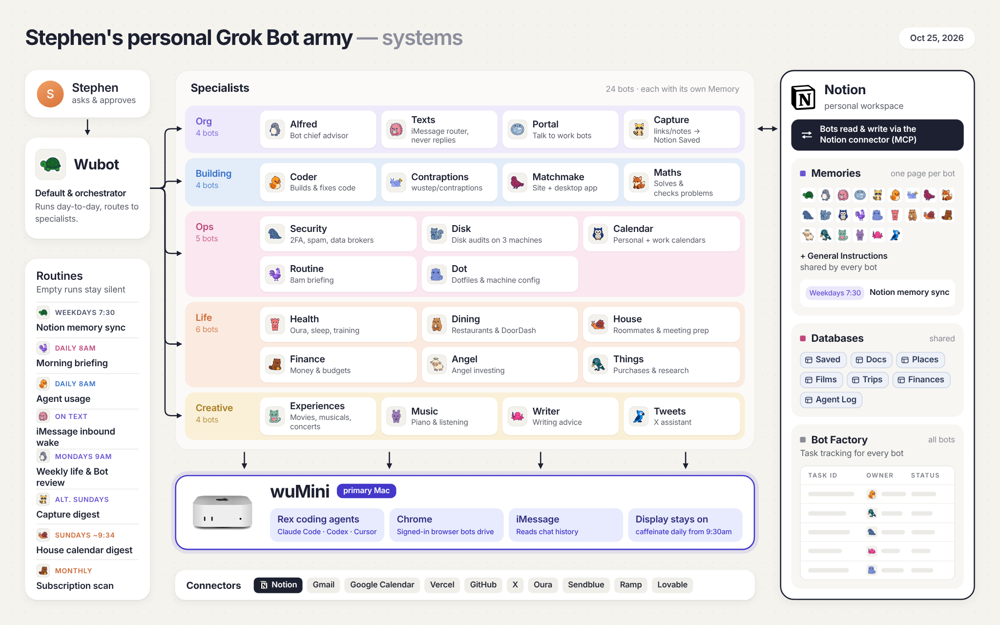
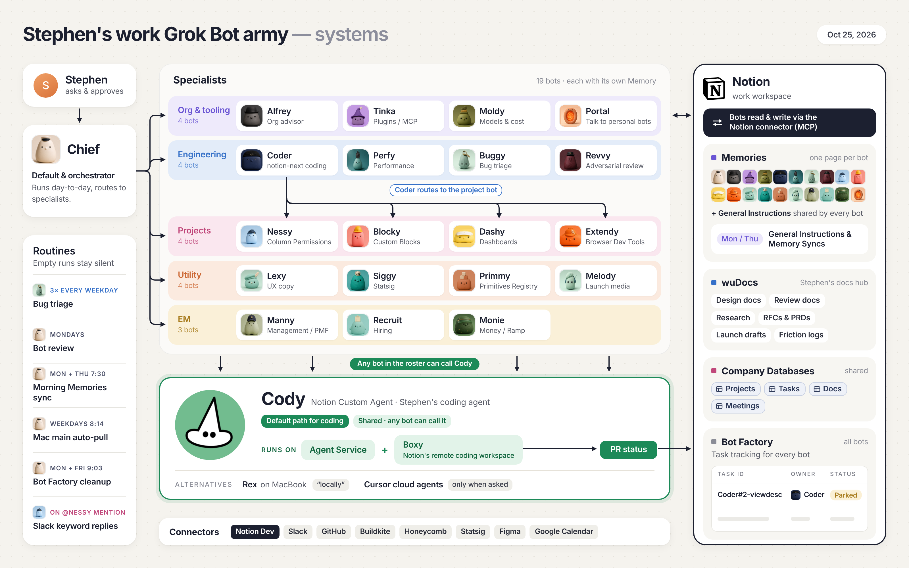

# my-bot-scripts

Small, self-contained scripts and services I use alongside my Grok Bot assistants: a relay between two bot accounts, an iMessage wake-up relay, Notion helpers, a message-count dashboard, and a few utilities. Each folder stands alone with its own README; nothing here needs the others.

Most scripts assume they run on a Grok Bot box (a Linux machine with `/workspace` and `/home/box/agent-data`), but every path and id can be overridden with env vars or flags.

## My Grok Bot setup

## Bot descriptions

Copy-pasteable Grok Bot descriptions and routines for the bots behind two of these projects. Each lives in its project's folder:

- [`bot-portal/PORTAL.md`](bot-portal/PORTAL.md): Portal, a switchboard bot that relays messages between two sets of bots through a Notion "Bot Portal"
- [`texts-relay/TEXTS.md`](texts-relay/TEXTS.md): Texts, an iMessage inbox bot that routes your texts to your other bots

## Projects

| Folder | What it does | Runtime |
|--------|--------------|---------|
| [`bot-portal/`](bot-portal/) | Vercel relay between a personal and a work bot account: end-to-end encrypted envelopes (AES-GCM + Ed25519), MCP endpoint, a Notion "Bot Portal" webhook router, and a passkey-gated viewer | Node 20, Vercel, Upstash Redis |
| [`texts-relay/`](texts-relay/) | Wakes a "Texts" bot when an iMessage arrives via Sendblue (puller + legacy loopback receiver) | Python 3.11+ |
| [`saved-tweets/`](saved-tweets/) | Rewrites Notion "Saved Tweet" pages into author + embed + quote + media blocks via the Notion API | Python 3 |
| [`capture-digest/`](capture-digest/) | Picks ~5 saved reading-list items for a digest (length mix, dead-link checks) | Python 3 |
| [`course-export/`](course-export/) | Saves logged-in course pages from Arc to local HTML for offline reading | macOS, Arc |
| [`bill-email-scan/`](bill-email-scan/) | Classifies bill and card emails for high balances, late payments, scams and prompt injection, and tracks due dates | Python 3, TypeSafe Jev API |
| [`msg-graph/`](msg-graph/) | GitHub-style heatmap of how many messages you send each bot, built from a Grok Bot box's search index ([preview](msg-graph/screenshot.png)) | Python 3 + static HTML |
| [`usage-tabs/`](usage-tabs/) | Opens the Cursor, Claude, Codex and Grok usage dashboards in a new Chrome window | bash |
| [`work-app-clones/`](work-app-clones/) | Builds blue "Work" copies of Claude, ChatGPT/Codex and Grok Bot with isolated profiles, so work and personal accounts run side by side | bash + JXA |
| [`bot-avatars/`](bot-avatars/) | Sticker-style bot avatar PNGs | – |

## Configuration

Secrets and personal values never live in the code. Each project reads them from env vars or from gitignored files next to the script:

| Project | Env vars |
|---------|----------|
| `bot-portal` | `KV_REST_API_URL`, `KV_REST_API_TOKEN`, `RELAY_PUBKEY_PERSONAL`, `RELAY_PUBKEY_WORK`, `WEBHOOK_HOST_ALLOWLIST`, `VIEWER_ORIGIN`, `VIEWER_USER`, `NOTION_WEBHOOK_VERIFICATION_TOKEN`, `NOTION_BOT_PORTAL_TOKEN`, `BOT_PORTAL_MESSAGES_DS`, `BOT_PORTAL_THREADS_DS` (or `_DB`), `BOT_PORTAL_WEBHOOK_URL`, `BOT_PORTAL_WEBHOOK_AUTH`, `WORK_BOTS` |
| `texts-relay` | `TEXTS_ALLOWED_NUMBERS` (required), `TEXTS_AGENT_ID` (required), `TEXTS_GATEWAY_PATH`, `TEXTS_SENDER_NAME`, `TEXTS_TZ`; files `webhook.secret`, `pull.url`, `pull.secret` |
| `saved-tweets` | `NOTION_API_TOKEN` (or `NOTION_ENV_FILE`), `SAVED_TWEETS_SKIP_PAGES` |
| `capture-digest` | `DIGEST_IN`, `DIGEST_OUT` |
| `bill-email-scan` | `JEV_API_KEY` (or `JEV_API_KEY_FILE` / `--key-file`) |
| `msg-graph` | `MSG_GRAPH_TZ`; optional `data/config.json` (copy `config.example.json`) |

See each folder's README for setup steps.

## Security

- Never commit `.env*`, `*.secret`, keys, `.vercel/`, exported data, or logs; `.gitignore` covers them.
- `bot-portal` stores only ciphertext and hashed tokens; see its README for the threat model.
- Found a security issue? Please open a private security advisory on this repo rather than a public issue.

## License

[MIT](LICENSE)
